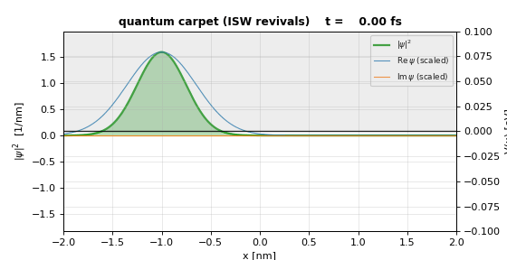

# 1D Time-Dependent Schrödinger Equation Solver

[](https://github.com/Alex-G-Gauthier/tdse-leapfrog/actions/workflows/ci.yml)


<p align="center">
  
  
</p>

A tested Python package and notebook series for simulating quantum wave-packet
dynamics in one dimension: tunnelling, resonant scattering, Rabi oscillations,
Landau–Zener transitions, photoionisation and high-harmonic generation.

**Author:** Alex G. Gauthier, B.S. Physics, California State University, San Bernardino
&nbsp;·&nbsp; [LinkedIn](https://www.linkedin.com/in/Alex-G-Gauthier/)

This started as my final project for **PHYS 3300 Computational Physics** at CSUSB,
which took **1st place for most challenging project** in the class competition
(free-particle propagation, quantum tunnelling and superposition states). I then
expanded it into the package below.

*The code was written with AI coding assistance; I chose the physics, the experiments and the validation
benchmarks, and checked the results against the analytic solutions.*

### Highlights
- **Four solvers compared head-to-head:** Visscher staggered leapfrog, FTCS,
  Crank–Nicolson and FFT split-operator.
- **Validated against exact physics:** closed-form solutions, a transfer-matrix
  $T(E)$ calculation, and cross-checks between independent solvers.
- **27 automated tests** (pytest) run on every push via GitHub Actions on Python 3.10–3.12.
- **Conservation diagnostics** (norm, energy, ⟨x⟩, ⟨p⟩, σₓ) for every experiment,
  plus 17 animated GIFs in [`figures/`](figures/).

## Method

We numerically integrate the 1D TDSE

$$
i\hbar \partial_t \psi(x,t) = \hat H \psi(x,t)
= \Big[-\tfrac{\hbar^2}{2m}\partial_x^2 + V(x,t)\Big]\psi(x,t)
$$

with the explicit *staggered-time leapfrog* scheme due to **P. B. Visscher
(Computers in Physics 5, 596 (1991))** — the only known explicit
finite-difference scheme for the TDSE that is both *conditionally stable* and
*conserves a quadratic invariant* exactly. We compare it against three
companion schemes: naïve Forward-Time Centered-Space (FTCS, unconditionally
unstable), the implicit Crank–Nicolson scheme (unconditionally stable, exactly
unitary), and an FFT-based **split-operator** Strang scheme (unitary, spectrally
accurate in space, $O(N\log N)$ per step). The four-way comparison motivates
the design choices in modern quantum solvers.

The numerical experiments progress from analytically solvable benchmarks
(free Gaussian, infinite well, harmonic oscillator) through fully numerical
scattering problems (rectangular and double barriers, double wells) to a
thoroughly explored suite of **time-dependent Hamiltonians** — driven
oscillator, Rabi oscillations, Landau–Zener transitions, adiabatic /
sudden crossover, infinite-well revivals (quantum carpets), autocorrelation
spectroscopy, photoionisation, and high-harmonic generation from a 1D
soft-Coulomb atom. A dedicated *breaking-points* notebook exhibits the
failure modes that every numerical PDE practitioner needs to recognize.

Every numerical experiment in this project includes a **six-panel
conservation diagnostics figure** monitoring simultaneously the ordinary
norm $\int|\psi|^2 dx$, the Visscher modified norm, the kinetic /
potential / total energy decomposition $\langle T\rangle, \langle V\rangle,
\langle H\rangle$, the position and momentum expectations
$\langle x\rangle, \langle p\rangle$, and the position uncertainty $\sigma_x$.
Each major time evolution is also saved as an animated GIF in `figures/`.

## Contents

```
Official Final Notebook.ipynb      single self-contained read-only tour of the
                                   project (no code; every static figure is
                                   embedded inline as a base64 data URI, so
                                   the notebook renders even with no other
                                   files present).

tdse/                              core simulation package
├── units.py                       SI scaling and display helpers
├── grid.py                        spatial / temporal grids
├── potentials.py                  V(x), V(x,t) library
├── boundaries.py                  hard wall, periodic, absorbing mask
├── solvers.py                     Visscher leapfrog, FTCS, Crank–Nicolson, FFT split-operator
├── observables.py                 <x>, <p>, <T>, <V>, <H>, norms, R/T, timeseries
├── analytical.py                  closed-form benchmarks + transfer-matrix T(E),R(E)
└── viz.py                         animations, space-time heatmaps, conservation panels

notebooks/
├── 00_theory_and_method.ipynb     derivation, stability, dispersion analysis
├── 01_free_and_bound_states.ipynb free Gaussian (+convergence-order plot), ISW, quantum SHO (eigenstate + coherent), finite well
├── 02_scattering.ipynb            step, barrier, double barrier, double well (transfer-matrix T(E))
├── 03_time_dependent.ipynb        NINE time-dependent experiments (see below)
└── 04_breaking_points.ipynb       eight failure modes + boundary comparison + FFT cross-check

figures/                           animated GIFs and static PNG snapshots
├── 01_free_gaussian.gif           free Gaussian wave-packet spreading
├── 01_isw_beating.gif             infinite-well two-state beats
├── 01_coherent_state.gif          quantum SHO coherent state oscillation
├── 02_step.gif                    step-potential scattering
├── 02_tunnelling.gif              quantum tunnelling through a barrier
├── 02_double_barrier_resonant.gif on-resonance resonant tunnelling
├── 02_double_well.gif             double-well tunnel oscillations
├── 03_driven_resonant.gif         driven SHO on resonance
├── 03_driven_off_resonant.gif     driven SHO with detuning
├── 03_rabi_isw.gif                Rabi oscillation in a driven ISW
├── 03_landau_zener.gif            Landau-Zener avoided-crossing transfer
├── 03_adiabatic_sudden.gif        widening-well adiabatic/sudden demo
├── 03_quantum_carpet.gif          fractional-revival quantum carpet in an ISW
├── 03_dc_stark_splitting.gif      DC Stark splitting in a finite well
├── 03_ac_stark_splitting.gif      AC Stark splitting / dressed states
├── 03_photoionisation.gif         pulsed-laser ionisation from a finite well
└── 03_hhg.gif                     HHG in a 1D soft-Coulomb atom

tests/
├── conftest.py                    sys.path stub so the suite runs without `pip install -e .`
├── test_basic.py                  fast (<2 s) package + analytical-reference checks
├── test_solvers.py                Visscher / CN / FFT / FTCS solver-level tests
└── test_time_dependent.py         §3-§9 physics regressions for notebook 03 (marked `slow`)

tools/
├── build_notebooks.py             single-source generator for the five notebooks/*.ipynb
├── build_stark_gifs.py            generates the supplementary AC / DC Stark-splitting GIFs for notebook 03
├── add_rabi_detuning_overlay.py   adds the detuning overlay to the Rabi figure
└── verify_visscher.py             standalone analytic-vs-numeric Visscher verification harness

.github/workflows/ci.yml           GitHub Actions: fast + slow test suites on Python 3.10-3.12
pyproject.toml                     installable package metadata (`pip install -e .`)
requirements.txt                   minimal runtime pin list (subset of pyproject)
SETUP.md                           Windows + VSCode "fresh PC" copy-paste install guide
setup_env.bat                      one-shot Windows installer driven by SETUP.md
```

## Companion deliverable

In addition to the five source notebooks under `notebooks/`, the
project ships **`Official Final Notebook.ipynb`** at the repo root —
a single self-contained, code-free Jupyter notebook that walks
through the project end-to-end in three parts (theory & method,
free / bound states, scattering).  It references the existing
`figures/*.gif` animations and embeds every static diagnostic figure
inline as a base64 data URI, so the file is fully portable and
renders even on a machine that has none of the other repository
files.  It contains every analytic derivation needed to motivate the
numerical method and links each section back to the corresponding
source notebook in `notebooks/`.

To rebuild every source notebook from scratch:

```powershell
python tools/build_notebooks.py          # regenerate notebooks/*.ipynb sources
```

## Contents of notebook 03 (the expanded time-dependent chapter)

| §   | system                              | physics / benchmark                                 |
|-----|-------------------------------------|-----------------------------------------------------|
| 1   | driven SHO on resonance             | classical envelope $\propto t$                      |
| 2   | driven SHO off resonance            | Rabi-like beats at detuning                         |
| 3   | driven infinite square well         | **Rabi oscillations**, population view, $\Omega_R$  |
| 4   | two swept Gaussian wells            | **Landau-Zener** $P = e^{-2\pi\Delta^2/(\hbar\alpha)}$ |
| 5   | widening finite well                | **Adiabatic vs sudden** approximation crossover     |
| 6   | Gaussian packet in an ISW           | **Wavepacket revivals / quantum carpets**           |
| 7   | displaced SHO coherent-state sum    | **Autocorrelation spectroscopy** ($C(t) \to E_n$)   |
| 8   | finite well + Gaussian laser pulse  | **Photoionisation** + photoelectron spectrum        |
| 9   | 1D soft-Coulomb atom + strong pulse | **High-harmonic generation**, $I_p + 3.17 U_p$ law  |

Every experiment reuses the same `tdse/` package, the same six-panel
conservation diagnostics, and the same space-time heatmap + GIF export
pipeline as the earlier notebooks.  Infrastructure added in support of
§3-§9 (all in the main `tdse/` package): **imaginary-time relaxation**
(`solvers.ground_state_imag_time`) for ground-state preparation of
arbitrary 1D potentials, sparse-Lanczos eigenstate finder
(`solvers.bound_eigenstates`), and projection / autocorrelation / dipole-
acceleration / power-spectrum observables
(`observables.populations`, `.autocorrelation`, `.dipole_acceleration`,
`.power_spectrum`).

## Quick start

```powershell
# Editable install -- pulls in numpy / scipy / matplotlib + notebook + test extras
python -m pip install -e ".[notebooks,test]"

python tools/build_notebooks.py            # regenerate notebook source
jupyter lab                                # open notebooks/00_theory_and_method.ipynb
```

`requirements.txt` is still provided for reproducibility but `pip install -e .`
is now the canonical install: it makes the `tdse` package importable from any
directory and configures the `pytest` test suite at the same time.

To re-execute every notebook end-to-end and refresh the GIFs:

```powershell
jupyter nbconvert --to notebook --execute --inplace `
    notebooks/00_theory_and_method.ipynb `
    notebooks/01_free_and_bound_states.ipynb `
    notebooks/02_scattering.ipynb `
    notebooks/03_time_dependent.ipynb `
    notebooks/04_breaking_points.ipynb
```

## Tests

```powershell
pytest -m "not slow"            # 20 fast tests, ~2 s
pytest -m slow                  # 7  §3-§9 physics tests, ~10 s
pytest                          # full suite (27 tests)
```

The fast tier checks package imports, SI constants, grid math, ISW eigenstate
orthonormality, the closed-form-vs-transfer-matrix barrier $T(E)$, observables
on known states, imaginary-time relaxation of the SHO ground state, and the
three solvers themselves (Visscher modified-norm machine-precision conservation,
CN unitarity, FTCS divergence, and leapfrog $\leftrightarrow$ CN cross-check).

The slow tier exercises Rabi oscillations, Landau-Zener (fast vs slow sweep
monotonicity), the sudden-approximation limit, the ISW half-revival, SHO
autocorrelation spectroscopy, photoionisation, and HHG dipole-acceleration
spectra -- one test per §3-§9 section of notebook 03.

CI runs both tiers across Python 3.10 / 3.11 / 3.12 on every push (notebooks are executed locally, not in CI); see
`.github/workflows/ci.yml`.

## Convention for space-time plots

We follow the *spacetime-diagram* convention familiar from special
relativity: **time on the horizontal axis, position on the vertical axis**.
A free-particle group-velocity worldline therefore appears as a straight
line of slope $v_g$ from bottom-left to top-right; a particle bouncing
in a well appears as a zig-zag.  Every space-time heatmap also has a
small panel on the *left* showing $V(x)$, drawn at the same vertical
scale as the heatmap so that potentials and dynamics are spatially aligned.

## Units

We work internally in SI units (metres, seconds, joules, kilograms). For
display we use **nm**, **fs**, **eV**, and electron mass $m_e$. The
`tdse.units` module supplies the necessary conversion constants and
ensures all numerical values stay in a numerically well-conditioned
range despite $\hbar \approx 1.055\times10^{-34}\mathrm{Js}$.

Probability densities are plotted in 1/nm; momenta in $\hbar$/nm.

## Validation strategy

The project relies on four independent ground-truth references:

1. **Closed-form analytic solutions** — `tdse.analytical` provides the exact
   free-Gaussian propagator, infinite/finite well eigenstates, harmonic
   oscillator eigenstates, step-potential reflection coefficient, and the
   rectangular-barrier transmission coefficient (Griffiths Eq. 2.171).
2. **Transfer-matrix method** — for arbitrary 1D piecewise-constant
   potentials (single barrier, double barrier, multilayer structures),
   `analytical.transfer_matrix_TR(E, x, V)` computes the *exact* $T(E)$
   and $R(E)$ from the same grid the leapfrog uses.  Wave-packet
   measurements are overlaid on the transfer-matrix curve in every
   scattering experiment.
3. **Crank–Nicolson reference solver** — implemented with sparse banded LU,
   exactly unitary in exact arithmetic.  Used for cross-checks against the
   leapfrog scheme.
4. **FFT split-operator solver** — Strang splitting evaluated in momentum
   space for the kinetic operator and position space for the potential.
   Spectrally accurate in $\Delta x$, exactly unitary, and used as a fully
   independent fourth scheme — exercised head-to-head against the
   leapfrog in §8 of `notebooks/04_breaking_points.ipynb`.

## References

1. P. B. Visscher, *A fast explicit algorithm for the time-dependent
   Schrödinger equation*, Computers in Physics **5**, 596 (1991).
2. A. Goldberg, H. M. Schey, J. L. Schwartz, *Computer-generated motion
   pictures of one-dimensional quantum-mechanical transmission and
   reflection phenomena*, Am. J. Phys. **35**, 177 (1967).
3. W. van Dijk *et al.*, *Accurate numerical solutions of the time-
   dependent Schrödinger equation*, Phys. Rev. E **75**, 036707 (2007).
