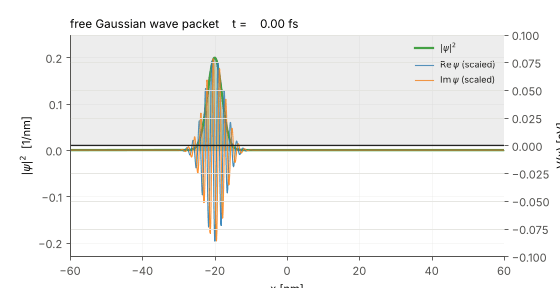
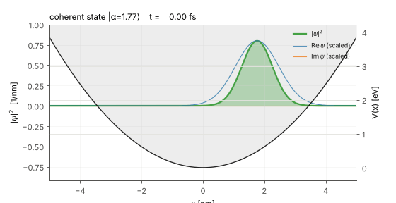
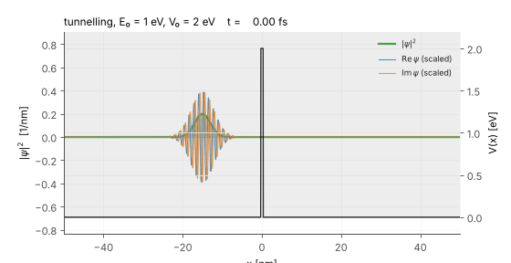
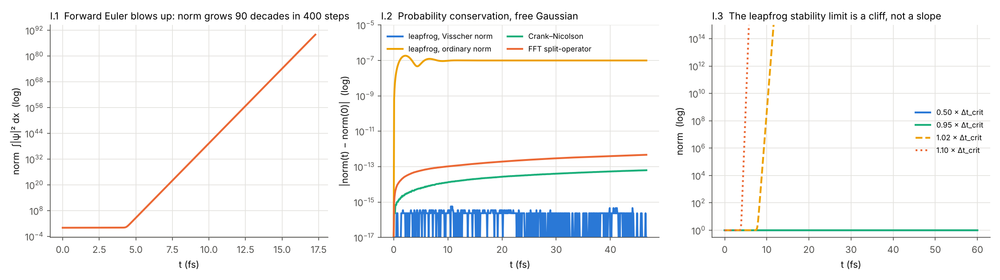
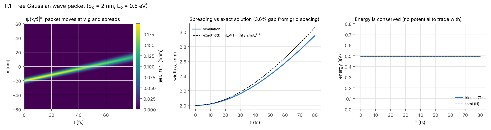
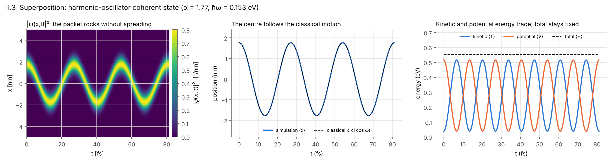
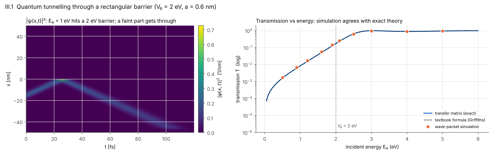

# Quantum Wave Packets: Free Particle, Superposition and Tunnelling

[](https://github.com/Alex-G-Gauthier/tdse-leapfrog/actions/workflows/ci.yml)


<p align="center">
  
  
  
</p>

My final project for **PHYS 3300 Computational Physics** at CSU San Bernardino, which won
**1st place for most challenging project** in the class competition. It solves the 1D
time-dependent Schrödinger equation numerically:

1. **Part I – Solver stress tests.** Four methods are tested on problems with known answers to decide
   which one to trust.
2. **Part II – Free particle and superposition.** A Gaussian wave packet in empty space, and a
   coherent state in a harmonic oscillator.
3. **Part III – Quantum tunnelling.** A wave packet hits a rectangular barrier, and its
   transmission is compared with theory.

**Author:** Alex G. Gauthier, B.S. Physics, CSU San Bernardino · [LinkedIn](https://www.linkedin.com/in/Alex-G-Gauthier/)
*The code was written with AI coding assistance. I chose the physics, the tests and the
benchmarks, and checked every result against the exact solutions.*

The full write-up is [`final_project.ipynb`](final_project.ipynb). Every number
below is re-computed by `python scripts/reproduce.py` and saved in
[`results/summary.json`](results/summary.json).

## Part I – Which solver can be trusted?

<p align="center"></p>

| Test (free Gaussian wave packet) | Result |
|---|---|
| Forward Euler (FTCS) | The norm grows by **~90 orders of magnitude in 400 steps**. It is unstable at every time step, as von Neumann analysis predicts. |
| Visscher leapfrog, its conserved norm | Changes by **6 × 10⁻¹⁶**: round-off only, with no drift. |
| Visscher leapfrog, ordinary ∫\|ψ\|² dx | Wobbles at 2 × 10⁻⁷ and stays bounded. |
| Crank–Nicolson / FFT split-operator | Norm drifts slowly, by 6 × 10⁻¹⁴ and 5 × 10⁻¹³. |
| Leapfrog stability limit Δt_crit = ħ / (½V_max + ħ²/m Δx²) | Flat at 0.95 Δt_crit. At **1.02 Δt_crit the norm explodes within ~10 fs**: the limit is a cliff, not a slope. |

**Choice:** the Visscher staggered leapfrog. It is explicit, so each step is cheap. It conserves a
norm exactly, and its stability limit is sharp and known in advance. Crank–Nicolson and the split-operator
method serve as independent cross-checks.

## Part II.1 – Free particle

<p align="center"></p>

A Gaussian packet (σ₀ = 2 nm, E₀ = 0.5 eV) travels through empty space.

- **Total energy** stays constant to 4 × 10⁻⁸.
- **Speed:** the packet moves at **0.4102 nm/fs**, which matches the grid's own group velocity,
  (ħ/m) sin(kΔx)/Δx = 0.4103 nm/fs. That is 2% slower than the continuum ħk/m, a predictable effect of
  the grid spacing (Δx = 0.1 nm).
- **Spreading** follows the exact σ(t) = σ₀√(1 + (ħt/2mσ₀²)²) to within 3.6%. Halving Δx cuts this
  to 0.9%, the 4× drop expected from a second-order method.

## Part II.3 – Superposition: a coherent state

<p align="center"></p>

A ground-state Gaussian is moved 1.76 nm off-centre in a harmonic potential (ħω = 0.153 eV). That
makes it a **coherent state**: a superposition of the oscillator's energy eigenstates, mostly n = 1–6
(mean ⟨n⟩ = 3.1). Quantum mechanics predicts that this packet moves like a classical particle
and keeps its shape. The simulation shows exactly that:

- **Position:** the centre ⟨x⟩ follows x_cl cos ωt to within **0.005 nm** (0.3% of the amplitude).
- **Width:** stays constant to **0.4%** over three periods.
- **Energy:** kinetic and potential energy trade back and forth, while the total stays at
  **0.5547 eV**, the exact ħω(|α|² + ½) for α = 1.77.

## Part III – Quantum tunnelling

<p align="center"></p>

A wave packet (σ = 1.5 nm) is sent at a 2 eV, 0.6 nm barrier at ten energies from 0.5 to 5 eV.

- **Transmission** is measured by counting the probability current that flows past a point beyond
  the barrier.
- **Exact reference:** the transfer-matrix T(E), averaged over the packet's spread of energies.
  It agrees with the textbook formula (Griffiths).
- **Agreement:** the simulation matches it to **within 2.2% at every energy**, from T = 0.0017 deep
  in the tunnelling regime to T = 0.95 above the barrier.
- **Grid convergence:** at 1.6 and 2.1 eV, a grid twice as coarse gives 6–9% errors. Halving the
  spacing cuts them about 4×, as a second-order method should.

## Changes from the original notebook

The notebook's text is kept as I submitted it. Re-running it for this repository turned up three things,
which are corrected in `scripts/reproduce.py` and in the figures above:

1. **The coherent-state ripples** that the notebook attributes to Δx came from the box. The
   packet's tail reached past the hard walls at ±3 nm. With walls at ±5 nm the width is constant to 0.4%.
2. **The coherent state's α.** The notebook calls it α = 2.5. In the standard convention, where
   ⟨x⟩ = 2σα, the same state has α = 1.77, and its measured energy confirms that value.
3. **Measuring transmission.** Measuring T as the probability right of the barrier at the final time
   undercounts fast packets, because the absorbing edge of the box has already removed part of them.
   Integrating the probability current as it passes fixes this.

## Method

The real and imaginary parts of ψ = R + iI are stored half a time step apart (Visscher, *Computers in
Physics* **5**, 596 (1991)):

R(t + Δt) = R(t) + (Δt/ħ) H I(t + Δt/2),  I(t + 3Δt/2) = I(t + Δt/2) − (Δt/ħ) H R(t + Δt),

with H = −(ħ²/2m)∂²ₓ + V(x) on a 3-point finite-difference grid. The other three solvers (FTCS,
Crank–Nicolson, FFT split-operator) live in the same package for comparison.

## Run it

```bash
pip install -e ".[test]"
python scripts/reproduce.py          # figures/*.png and results/summary.json (~2 min)
python scripts/reproduce.py --gifs   # also redraw the three GIFs
pytest                               # 26 tests: solvers, exact references, and the three simulations
```

```
final_project.ipynb             the project write-up (as submitted)
scripts/reproduce.py            re-runs Parts I–III and redraws every figure
tdse/                           solvers, grids, potentials, observables, exact solutions, plotting
tests/                          test_solvers.py (Part I), test_projects.py (Parts II–III), test_basic.py
results/summary.json            every number quoted above
```

## References

- P. B. Visscher, "A fast explicit algorithm for the time-dependent Schrödinger equation,"
  *Computers in Physics* **5**, 596 (1991).
- D. J. Griffiths, *Introduction to Quantum Mechanics*: free Gaussian packet, harmonic oscillator,
  rectangular-barrier transmission.

MIT License.
